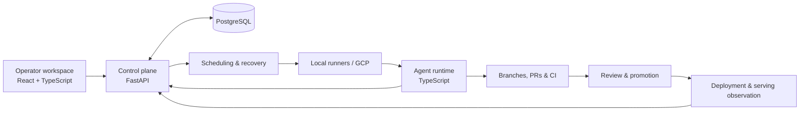

# Blueprint AI Studio

An AI coding-agent orchestration platform with a React operator workspace, a Python control plane, a TypeScript agent runtime, and local/cloud runners.

Blueprint coordinates repository tasks, tracks execution and recovery, and connects changes to review and release workflows. This is a paused personal project developed with AI assistance. The code and engineering history are retained here; running the full system requires configured infrastructure and integrations.

[Architecture](docs/portfolio/ARCHITECTURE.md) · [Engineering case study](docs/portfolio/CASE_STUDY.md) · [Local setup](CONTRIBUTING.md) · [Verification](docs/portfolio/VERIFICATION.md)

## Run the existing UI

Requires Node.js 22+ and npm. From the repository root:

```bash
npm ci
npm run dev
```

Open http://localhost:3001. The dashboard uses the backend API and authentication configuration described in [CONTRIBUTING.md](CONTRIBUTING.md).

`npm run demo` starts the **same application** on http://127.0.0.1:3002. It is a convenient frontend launch command; the backend and configured integrations are still needed to operate the system. See the [local UI guide](docs/portfolio/DEMO.md).

For a recorded look at the application, the [operator walkthrough](docs/walkthroughs/v26-operator-walkthrough.md) includes screenshots and observations from an earlier session.

## How it fits together



| Directory | Responsibility |
| --- | --- |
| [`admin-ui/src/`](admin-ui/src/) | Operator workspace: conversations, projects, pipeline, fleet, and settings |
| [`backend/app/`](backend/app/) | API, scheduling, task lifecycle, recovery, permissions, and releases |
| [`agent/src/`](agent/src/) | Task handlers, provider execution, checkpoints, and telemetry |
| [`scripts/`](scripts/) | Operator CLI, self-hosted runners, checks, and deployment tooling |
| [`infra/`](infra/) | Terraform, VM images, networking, backup, and recovery |
| [`docs/`](docs/README.md) | Guided reading, implementation references, and operations |
| [`backend/testing/`](backend/testing/) | Backend tests and invariant checks |

The [architecture guide](docs/portfolio/ARCHITECTURE.md) maps these boundaries to source files. The [case study](docs/portfolio/CASE_STUDY.md) covers persistent task state, concurrency, revision-bound review, and deployment observation, with tradeoffs and representative tests.

## Verify changes

```bash
# Frontend
npm run typecheck --workspace admin-ui
npm run lint --workspace admin-ui
npm run test:run --workspace admin-ui

# Agent
npm ci --prefix agent
npm run typecheck --prefix agent
npm test --prefix agent

# Backend: select the files covering your change
bash scripts/test-backend.sh testing/test_task_capabilities.py
```

The [verification record](docs/portfolio/VERIFICATION.md) lists checks run during cleanup. Backend tests use an isolated database. Use targeted backend files on agent VMs; the full suite and operational frontend build run in CI.

## Documentation and history

Start with the [documentation index](docs/README.md). For operation, see the [development guide](docs/DEVELOPMENT_GUIDE.md), [runner runbook](docs/RUNNER_RUNBOOK.md), and [deployment guide](Deploy.md).

Historical plans remain available at their original paths. [History preparation](docs/portfolio/HISTORY.md) describes the private Git-history backup and how to produce a separate clean checkout.

## License

The current [license](LICENSE) reserves all rights to the copyright holder.
