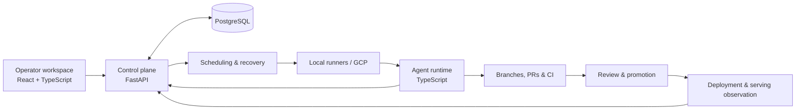

# Blueprint AI Studio

An AI coding-agent orchestration platform with a React operator workspace, a Python control plane, a TypeScript agent runtime, and local/cloud runners.

Blueprint coordinates repository tasks, tracks execution and recovery, and connects changes to review and release workflows. This is a paused personal project developed with AI assistance. Running the full system requires configured infrastructure and integrations.

[Local setup](CONTRIBUTING.md) · [Architecture](docs/ARCHITECTURE.md) · [Testing](docs/TESTING_GUIDE.md)

## Run the existing UI

Requires Node.js 22+ and npm. From the repository root:

```bash
npm ci
npm run dev
```

Open http://localhost:3001. The dashboard uses the backend API and authentication configuration described in [CONTRIBUTING.md](CONTRIBUTING.md).

`npm run demo` starts the frontend on http://127.0.0.1:3002. The backend and configured integrations are needed to operate the system.

## How it fits together



| Directory | Responsibility |
| --- | --- |
| [`admin-ui/src/`](admin-ui/src/) | Operator workspace: conversations, projects, pipeline, fleet, and settings |
| [`backend/app/`](backend/app/) | API, scheduling, task lifecycle, recovery, permissions, and releases |
| [`agent/src/`](agent/src/) | Task handlers, provider execution, checkpoints, and telemetry |
| [`scripts/`](scripts/) | Operator CLI, self-hosted runners, checks, and deployment tooling |
| [`infra/`](infra/) | Terraform, VM images, networking, backup, and recovery |
| [`docs/`](docs/README.md) | Setup, architecture, testing, and operating instructions |
| [`backend/testing/`](backend/testing/) | Backend tests and invariant checks |

The [architecture guide](docs/ARCHITECTURE.md) maps these boundaries to source files.

## Verify changes

```bash
# Frontend
npm run typecheck --workspace admin-ui
npm run lint --workspace admin-ui
npm run test:run --workspace admin-ui

# Agent
npm ci --prefix agent
npm run typecheck --prefix agent
npm test --prefix agent

# Backend: select the files covering your change
bash scripts/test-backend.sh testing/test_task_capabilities.py
```

Backend tests use an isolated database. Use targeted backend files on agent VMs; the full suite and production frontend build run in CI. See the [testing guide](docs/TESTING_GUIDE.md).

## Documentation

Start with the [documentation index](docs/README.md). For operation, see the [runner runbook](docs/RUNNER_RUNBOOK.md) and [deployment guide](Deploy.md).

## License

The [license](LICENSE) permits review and local, non-commercial evaluation.
Other rights are reserved by the copyright holder.
