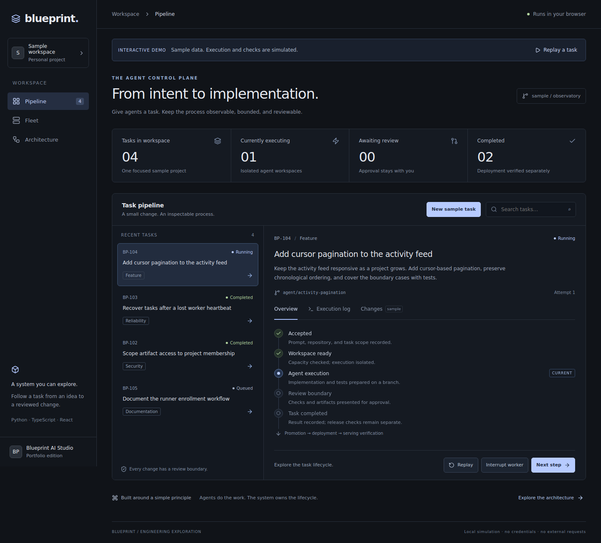
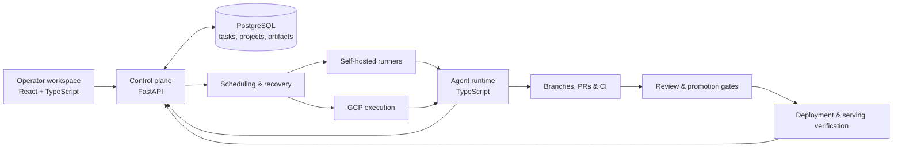

<div align="center">

# Blueprint

### An observable control plane for AI coding agents.

Turn a repository and a task into isolated execution, a reviewable change, and a verified release.

**[Explore the demo](#try-it-locally)** · **[Architecture](docs/portfolio/ARCHITECTURE.md)** · **[Engineering case study](docs/portfolio/CASE_STUDY.md)** · **[Verification](docs/portfolio/VERIFICATION.md)**



*The portfolio demo uses sample data and simulated execution. It runs entirely in your browser.*

</div>

## Why this exists

Running a coding agent is easy. Managing its work after a process crashes, a review changes, or a deployment fails is a systems problem.

Blueprint explores that problem: a persistent task lifecycle, isolated workers, observable execution, bounded recovery, and explicit review and release decisions. The platform includes a React operator workspace, a Python control plane, a TypeScript agent runtime, self-hosted runners, and GCP infrastructure.

This is a paused personal project, developed with AI-assisted implementation and review. The repository preserves the working system and its tests alongside a small, credential-free demonstration. Live infrastructure and model execution require separate configuration.

## Try it locally

Requires **Node.js 22+** and npm. From the repository root:

```bash
npm ci
npm run demo
```

Open **http://127.0.0.1:3002**. No database, cloud account, model key, or GitHub login is needed.

- **New sample task** accepts a title and goal locally.
- **Replay a task** follows queue → workspace → execution → review.
- **Interrupt worker**, then **Retry task**, to explore recovery.
- Inspect the sample patch and choose **Approve sample** to finish the task.
- Open **Fleet** and **Architecture** for the execution boundaries and source map.

Build a portable static demo with `npm run demo:build`; serve it with `npm run demo:preview`. The output is `admin-ui/dist-demo/`. See the [demo guide](docs/portfolio/DEMO.md) for the walkthrough and browser checks.

## The system



| Engineering concern | Implementation |
| --- | --- |
| Work survives a worker process | Persisted task state, heartbeats, bounded retries, and recovery sweeps |
| Concurrent actors mutate the same task | Canonical row-lock helpers and explicit admission decisions |
| Agents need limited authority | Task-scoped credentials and a validated runtime capability contract |
| A successful agent run needs review | PR lifecycle, review/fix workflows, and merge authority checks |
| A merge is only one release step | CI qualification, promotion, deployment artifacts, and serving observations |

The [case study](docs/portfolio/CASE_STUDY.md) connects these decisions to representative source files and tests, including the tradeoffs and limitations.

## Repository map

| Directory | Responsibility |
| --- | --- |
| [`backend/app/`](backend/app/) | API, scheduling, task lifecycle, recovery, permissions, and releases |
| [`admin-ui/src/`](admin-ui/src/) | Operator workspace; [`demo/`](admin-ui/src/demo/) is the standalone presentation |
| [`agent/src/`](agent/src/) | Task handlers, provider execution, checkpoints, and telemetry |
| [`scripts/`](scripts/) | Operator CLI, self-hosted runners, checks, and deployment tooling |
| [`infra/`](infra/) | Terraform, VM images, networking, identity, backup, and recovery |
| [`docs/`](docs/README.md) | Guided reading, implementation references, and operations |
| [`backend/testing/`](backend/testing/) | Backend tests and invariant checks |

## Develop and verify

```bash
# Demo workflow tests
npm run demo:test

# Dashboard types and unit tests
npm run typecheck --workspace admin-ui
npm run test:run --workspace admin-ui

# Dashboard lint
npm run lint --workspace admin-ui

# Agent types (install agent dependencies first)
npm ci --prefix agent
npm run typecheck --prefix agent

# Targeted backend checks; select files covering your change
bash scripts/test-backend.sh testing/test_task_capabilities.py
```

Start with [CONTRIBUTING.md](CONTRIBUTING.md). Backend tests use an isolated database; run targeted files rather than the full backend suite on agent VMs. The [verification record](docs/portfolio/VERIFICATION.md) states exactly which checks were run for this snapshot.

For the operational application, read the [development guide](docs/DEVELOPMENT_GUIDE.md), [runner runbook](docs/RUNNER_RUNBOOK.md), and [deployment guide](Deploy.md). The static demo does not exercise model providers, GitHub mutations, or live deployment.

## Project history and license

The portfolio presentation curates a larger development history. Historical plans and recorded walkthroughs remain available through the [documentation index](docs/README.md); they carry their original scope and are not a claim about current runtime behavior. See [history and snapshot preparation](docs/portfolio/HISTORY.md) for preserving the original Git history and producing a clean portfolio checkout.

Source availability does not grant reuse rights. The current [license](LICENSE) reserves all rights to the copyright holder.
