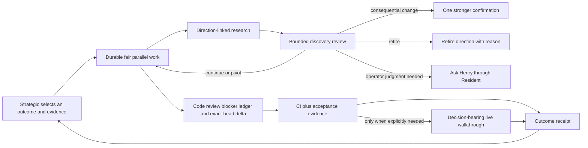

# Blueprint RSI convergence checkpoint — 2026-08-01

Status: verified convergence checkpoint `114370d53` plus the pre-main
proof-contract and Resident idle-cost closure on `codex/rsi-integration`. The
Blueprint pipeline remains paused. This branch has not been deployed or
live-tested against an unpaused autonomous cycle.

## North star

Blueprint is not meant to maximize autonomous activity. It has two jobs:

1. Be a real recursive product-improvement loop: keep up with advances and
   become a genuinely better product without requiring Henry to continuously
   supervise the harness.
2. Multiply Henry's effective frontier: focus his attention on the work and
   research that matter while improving useful output per unit of Henry
   attention, elapsed time, money, and maintenance burden.

The optimization target is therefore **important, verified progress**, not task
count, PR count, line count, agent utilization, or accumulated telemetry.

## What existed before the pause versus what was built during it

### Pipeline-produced foundation before the pause

The autonomous pipeline produced a substantial working substrate:

- parallel task graphs, dependency handling, runners, provider routing, and PR
  delivery;
- Strategic cycles, directions, research tasks, review fan-out, CI, release
  qualification, and promotion machinery;
- acceptance criteria, audit/challenge paths, Resident, and a broad task-type
  registry;
- many real product changes shipped through the same machinery.

That foundation proved Blueprint could build a lot in parallel. It did not yet
prove that the loop was reliably choosing and compounding the *right* changes.
Its characteristic failure was activity without convergence: research that did
not alter a decision, reviews that repeated or disappeared, evidence that was
produced but not consumed, expensive periodic wakes, orphan or unfair spawns,
shadow systems, and new telemetry/hardcoded gates accumulating faster than old
machinery was retired.

### Pause-era Henry + Codex work

While autonomous building was paused, the directly steered work concentrated on
the control plane and interaction mode rather than asking the old loop to add
more features to itself. That work includes:

- Chat/Workday and Resident improvements so Henry can work with Blueprint
  directly without replacing the existing interaction model;
- durable outcome receipts and semantic milestone watches instead of treating
  task completion as proof of progress;
- fair, durable parallel spawn admission and actionable-only Resident wakes;
- direction-linked research whose findings become real only after downstream
  work is durably wired;
- a bounded discovery-review decision loop that can continue, pivot, retire, or
  ask Henry, with expensive confirmation reserved for consequential changes;
- an exact-head review-blocker ledger and removal of overlapping reviewer
  machinery, including the second automatic cross-cutting security-audit VM;
- exact-target merge authority plus retirement of GitHub native auto-merge, so
  Blueprint itself rechecks the evidence-bearing base/head pair before every
  autonomous merge instead of delegating authority over a mutable future head;
- exact release receipts, so the promoted version, tag, and next-version base
  are bound to GitHub's merge result for the qualified `release-vN` PR rather
  than a later, unrelated tip of the promotion target;
- release qualification that reuses ordinary acceptance/review/CI evidence and
  runs a costly live walkthrough only when explicitly selected as decision
  evidence;
- retirement of systems that were shadowed, superseded, or write-only.

The distinction matters: the pre-pause pipeline built much of the product and
execution harness; the pause-era work is making that harness capable of
selecting, verifying, learning from, and stopping work coherently.

## Integrated implementation map

- Outcome receipts, semantic watches, fair direct spawning, actionable
  Resident wakes, retry floor, and bounded discovery decisions:
  `842f59a14`, `f11fbec56`, `fb042754b`, `86da3e40d`, `cdec5bc2f`,
  `30a5bce51`, `f6d0d8bf7`, `a7942422f`, `bbd46fd86`.
- Authoritative review ledger, exact-head proof, discovery packet extraction,
  and pending execution ownership: `7b01ad37d`, `b92705cc3`, `b52851b53`,
  `ee6ea1ad0`, `31aa9cedc`, `a3a102c48`, `949109fe5`.
- Exact autonomous merge targets, exact release receipts, one managed
  promotion state machine, and final native-auto retirement: `4a8310643`,
  `fbffd64d9`, `1e2c91526`, `85dd21df8`.
- Structural deletion/size cleanup and final authority/test convergence:
  `710698c13`, `114370d53`.

## Canonical self-improvement loop

The important boundaries are:

- Strategic owns the outcome, evidence contract, and continue/pivot/retire
  decision. It does not micromanage every worker step.
- Parallelism remains a first-class property. Admission is durable and fair;
  verification does not serialize unrelated work.
- Research is not a finding until its child wiring is finalized. Deferred
  intent and failed/unrouted artifacts cannot steer later decisions.
- Routine research completion goes to bounded discovery review, not an
  expensive Resident wake. Resident is reserved for actionable operator
  decisions and semantic receipts.
- Review means an authoritative issue ledger at an exact candidate head. A
  same-head omission cannot erase a blocker; a changed head can close it only
  with fixed, refuted, or adjudicated evidence.
- Review/fix execution has one structural claim fence. Both a new `/claim` and
  its warm-handoff/idempotent-replay branch acquire the repository/PR admission
  lock before re-locking the task, recheck the live PR, reject stale review/fix
  targets, and revoke merge authority before any handler or code-writing fix
  becomes executable. A warm handoff may reserve setup before the replay, so
  producer-side admission is still kept for cost; generic recovery code can at
  worst create a queued/reserved row, not start work across publication.
- A pending post-commit review/fix continuation is a real, generation-fenced
  lease. Each new pending payload receives a generation token and each sweeper
  claim receives a claim token; dispatch, retry, clear, and abandon operations
  revalidate both against the locked task. Archiving cannot hide a canonical
  pending owner, and manual requeue reacquires PR admission before reading the
  definitive task row. A stale sweeper or operator snapshot therefore cannot
  consume, clear, or run a newer continuation while merge authority proceeds.
- Every automatic merge is bound to the exact head whose CI, scan, and review
  evidence was evaluated. A force-push cannot silently substitute newer bytes
  between decision and GitHub's merge primitive.
- Release success requires a bound receipt: the release PR must target the
  expected branch, carry the qualified candidate as its head, be authoritatively
  merged, and provide the merge commit that becomes `promoted_sha`. Candidate
  ancestry is corroboration, not proof that Blueprint's release PR landed, and
  a later branch-tip read is never substituted for the merge receipt.
- Pending release promotion has one state machine: `managed_check_wait`. It
  checks CI, reruns migration safety, rereads the live base/head pair, and uses
  GitHub's expected-head compare-and-swap. Native auto-merge, its separate
  landing reconciler, alerts, UI state, and Strategic vocabulary are retired.
  Malformed/timeless legacy rows are normalized or failed under lock. If a
  timed-out PR cannot be confirmed terminal, the same state machine retains its
  PR identity as cleanup debt and prevents a duplicate redrive until the old PR
  is closed or reconciled as an exact successful merge.
- The established cheap initial-review bypass is explicit backend policy state
  (`review_not_required`), never inferred from an empty history or a legacy
  approval token. Once a fix or real review begins, exact-head review authority
  supersedes that bypass.
- Existing acceptance, review, and CI evidence is the default qualification
  input. A live walkthrough consumes another checkout and is run only when the
  release claim genuinely depends on product behavior those signals cannot
  establish.
- A direction succeeds only when its declared success evidence is met and its
  challenge is approved. Exhausted, stopped, or disproven directions retire
  explicitly instead of lingering as activity generators.
- Discovery admission freezes the canonical direction proof contract
  (`success_evidence`, `retirement_condition`, and
  `implementation_constraints`) into the decision snapshot. Automatic and
  operator-created successors inherit that exact contract; a later bet can
  change the mechanism but cannot omit or rewrite its proof boundary.

## Cost and efficiency behavior

- Discovery review uses a bounded evidence packet and packet-only workspace;
  it no longer pays for a full repository clone/tree scan on every decision.
- Routine discovery uses the normal review tier. A stronger model is invoked
  only when the server verifies that the proposed change is consequential, so
  model overhead does not grow proportionally as cheaper worker models improve.
- Resident is not awakened for routine research completion. It receives
  operator questions and compact semantic receipts after durable state changes.
- Cheap polling and heartbeats do not invoke the Resident model. First-turn,
  operator, follow-up, watch/barrier, and semantic work-state changes still wake
  it immediately, while unchanged-state model exploration is a distinct,
  configurable 1h--24h cadence with a 4h default. The retired 10-minute floor
  has no production compatibility path.
- Qualification consumes evidence already earned during implementation. The
  live-stack walkthrough is explicit, attempt-bound, exact-SHA, and required by
  the verdict when selected; it is neither fleet-wide nor shadow evidence.
- Direct spawns hold durable admission, are ordered across projects, skip paused
  projects, and advance no-room requests instead of hot-looping or starving
  later projects.
- Review/fix admission is deduplicated when produced and revalidated again at
  both the new-claim and idempotent-replay branches. This keeps safety
  structural without paying for a new agent or GitHub probe on every ordinary
  task.
- Payload, intent, bet, and evidence packets are bounded. Missing required
  decision evidence fails closed; redundant telemetry does not force an
  inconclusive decision.
- Standard parallel code review remains. Named overlapping Fresh Reviewer and
  rereview-waiver machinery is removed rather than left dormant. Large-scope
  review already covers security, interface compatibility, and cross-module
  tests, so it no longer spawns a second hardcoded cross-cutting safeguard task
  and merge gate for the same PR.
- Release promotion no longer has two owners. One managed waiter handles every
  pending promotion PR, while a narrow normalization boundary converts
  persisted pre-cutover rows without retaining the old runtime, alerts, or UI.
- Promotion bookkeeping consumes GitHub's merge SHA directly. Crash recovery
  resolves the deterministic `release-vN` PR and requires its exact candidate,
  base, merged state, and merge commit instead of treating candidate ancestry
  or the current target tip as a release receipt.

## Systems kept and systems retired

Kept as canonical:

- Strategic, directions, parallel task execution, direction-linked research;
- bounded discovery review plus one consequential confirmation path;
- Resident for actionable decisions and semantic receipts;
- standard independent code review with an exact-head blocker ledger;
- CI, acceptance criteria/evidence, and release qualification;
- explicit walkthrough product probe for the narrow cases that need it.

Retired or cut from active paths:

- discovery shadow-mode configuration and shadow sessions;
- criterion-coverage trial enrollment, ingestion, reaping, flags, and task type;
- qualifier VM smoke as a current qualification dimension;
- raw/unfinalized research-artifact fallbacks and the `already_spawned` bypass;
- named Fresh Reviewer executor/settings/operator/UI/analytics surface;
- automatic cross-cutting safeguard spawning, thresholds, release/reaper hooks,
  and its duplicate merge state machine (the general `security_audit` task type
  remains available for real standalone security work);
- dead review-second-opinion thresholds, context tombstones, and
  `surviving_issues` fallbacks left behind after their executor disappeared;
- rereview-waiver paths that could hide unresolved blockers;
- GitHub native auto-merge producers and helper, the duplicate pending-auto
  reconciler and stall alarm, `promotion_in_flight` state, and their backend,
  agent, Strategic, CLI, notification, and UI vocabulary;
- stale mock/export entries and superseded configuration references.

Historical migrations remain immutable. A small amount of vocabulary is kept
only so old data remains interpretable during the rollback window:
`LEGACY_SR_ANALYTICS_KEYS` still names the retired
`fresh_reviewer_trend`/`sr_reviewer_disagreements` fields expected by migration
0696, and `_REVIEWER_ORIGINS` still recognizes historical `reviewer_*` outcomes
so they are not misattributed to author self-review. These are compatibility
tombstones, not producers, executors, UI surfaces, or decision paths. Retired
analytics data can be removed after the rollback window rather than keeping its
runtime machinery alive.

## Verification completed at this checkpoint

- Core convergence slice: 1,106 targeted backend tests plus focused endpoint,
  registry, agent typecheck, and unit checks passed before integration.
- Qualification + walkthrough: 191 PostgreSQL tests passed across the focused
  qualifier and task-completion files.
- Qualification retry/cache/promotion paths: 243 PostgreSQL tests passed across
  the focused finalize/redrive suites.
- Direct-spawn race/fairness slice: 13 PostgreSQL tests passed; the SQLite
  companion passed 12 with one expected PostgreSQL-only skip.
- Discovery-review slice: 31 focused backend cases plus agent packet-workspace,
  TypeScript, lint, and unit checks passed.
- Review safety audit: 30 focused authority/claim/requeue cases, all 105
  `test_services.py` cases, and two archive/bulk cases passed before the final
  integration rerun.
- Exact release/promotion: the managed-promotion behavior matrix passed 10/10;
  exact-receipt/reconciliation slices, syntax checks, duration-contract checks,
  and the 508-route import check passed after rebase. The final combined run
  below includes the corrected staged-rollup exact-target seam.
- Structural cleanup: findings tests passed 15/15 and size guards passed 4/4;
  the final recovery-claim extraction then passed 10/10 focused claim/sweep
  cases and its two size/coverage guards without raising the 1,100-line cap.
- Final combined backend head: 33/33 PostgreSQL review-authority,
  post-commit-claim, pending-requeue, and staged-rollup race cases passed;
  182/182 standalone merge-lock, dual-head-guard, module-size, guardrail
  coverage, and retired-criterion invariants passed. The application imported
  all 508 routes in both runs.
- Final agent head: `tsc --noEmit` passed; the authoritative walkthrough plus
  specialized suites passed 165/165 after deleting the stale duplicate
  walkthrough block. Additional focused qualification-state, research-plan,
  and PR-helper slices passed 2, 297, and 6 cases respectively, with 14
  platform-specific PR-helper cases skipped.
- Pre-main goal-loop closure: discovery admission/review passed 51/51 focused
  PostgreSQL cases; Resident pacing passed 370/370 focused Agent cases plus
  `tsc --noEmit`; exact admin settings and Workday protection contracts passed
  4/4 backend cases. A tracked residue scan found the retired 10-minute key only
  in the negative test that asserts it is rejected.
- Final frontend head: TypeScript compilation and the test-file baseline check
  passed; ESLint completed with zero errors (579 warnings); the three changed
  lifecycle/vocabulary files passed 271/271 Vitest cases. Package locks did not
  change.
- Final hygiene: `git diff --check` passed. Runtime/test/UI residue scans found
  no native-auto promotion state, rereview waiver, surviving-issue fallback, or
  retired merge helper. The sole `Fresh Reviewer` phrase is the documented
  old-data compatibility tombstone in `sr_analytics_store.py`.

No full backend suite was run locally: project policy reserves that expensive
45–60 minute matrix for the automain-to-main promotion gate. A direct full
agent run from restricted Windows was also not a valid signal because spawned
`bash` and the extensionless pyenv `python3` shim are not executable from that
Node environment; all changed agent surfaces were rerun successfully in Git
Bash. `npm ci` reported five current dependency advisories (two high, three
critical); this checkpoint neither introduced nor resolved them.

## Live test and unpause protocol

Do not unpause broadly immediately after deploy.

1. Keep execution paused and drain old-agent work. Before cutover:

   - use the admin bulk action to cancel every nonterminal task, including
     `BLOCKED`/`PARKED`, whose context contains
     `operator_requested_review_for`; these were stored as ordinary `create`
     jobs and must not reach an agent after their special executor is removed;
   - cancel every nonterminal `security_audit` task whose context contains
     `safeguard_for_task_id`. For each parent carrying `safeguard_task_id`, do
     not blindly clear `requires_approval`: reconcile the exact live PR through
     the standard review/CI authority, then remove the retired safeguard context
     keys once the real disposition is durable;
   - enumerate every open PR chain carrying `rereview_waived`, a CI/conflict/
     migration review-skip history, `stale_head_consecutive_discards`, or a
     parked `review_approved`/legacy `verdict=APPROVE`; require one standard
     review of the exact live base/head before merge, without inventing missing
     historical SHAs;
   - remove the retired `enable_fresh_reviewer` build-config JSON and dismiss or
     update existing open `sr.lone_checker` alerts whose deduplicated text still
     says Fresh Reviewer was auto-enabled.

   - enumerate live open PRs in every managed repository by GitHub's actual
     `autoMergeRequest`, not by Blueprint's possibly stale database markers.
     For each Blueprint-owned request, first snapshot repository, PR number,
     node id, base SHA, and head SHA; disable it with GitHub's
     `disablePullRequestAutoMerge`; then reread the PR and require auto-merge to
     be absent with the PR still open on the same head, or reconcile an already
     terminal PR. Report human-owned auto-merge requests rather than changing
     them;
   - under row lock, normalize persisted release `promotion_pending` rows onto
     `managed_check_wait`, removing native-auto fields. Preserve and drain any
     cleanup-required PR identity before allowing a redrive. Run release, task,
     and rollup reconciliation while still paused and verify that no live
     Blueprint-owned auto-merge request remains armed before unpausing.

   This is a one-time paused-state cleanup, not a reason to retain a legacy
   executor or compatibility decision path.
2. Cut over the backend and agent together. Mixing an old agent with the new
   backend (or the reverse) can reintroduce the deleted reviewer-merge/waiver
   semantics. Verify the serving backend and agent revisions, schema head, and
   runner compatibility before admitting work.
3. Create one bounded test direction with an explicit outcome, declared success
   evidence, hard spend/time limits, and a small parallel work set.
4. Allow one research-to-discovery cycle. Confirm the finding is finalized only
   after child wiring, routine review does not wake Resident, and a
   non-consequential decision does not invoke the stronger confirmation tier.
5. Exercise continue or pivot once, then a retire path. Confirm each produces a
   semantic receipt and leaves no due spawn request, orphan task, shadow review,
   or stale direction state.
6. Run one qualification without a product probe and verify it reuses existing
   CI/review/acceptance evidence. Only if the test release has a genuinely live
   behavior claim, run a second qualification explicitly requesting
   `walkthrough_e2e`; verify its exact-SHA report and evidence affect the actual
   verdict.
7. Compare delivered result, elapsed time, spend, Henry interventions, and
   maintenance residue against the bounded test contract. If clean, expand to a
   small number of real directions before restoring normal cadence.

Stop and re-pause on any of the following:

- unfinalized/failed research influences a decision;
- a same-head review omission closes a blocker;
- a review/fix starts on a stale or terminal PR, or a terminal review/fix with
  pending post-commit work becomes invisible to merge authority;
- a native GitHub auto-merge request remains armed, or an autonomous merge is
  attempted without fresh exact-target authority;
- a promoted version/tag/next-version base does not equal the exact merge SHA
  returned by, or authoritatively resolved from, its qualified release PR;
- a routine discovery decision wakes Resident or invokes expensive
  confirmation;
- a requested product probe is absent from, or reusable across the wrong,
  qualification verdict;
- a project is starved, a paused project dispatches, or an orphan task appears;
- the direction generates tasks without measurable movement toward its declared
  success evidence;
- repeated operator recovery is needed, or spend exceeds the test contract.

## Decision after the live test

The question is not “did the agents stay busy?” It is:

> Did Blueprint choose a worthwhile improvement, execute it in parallel,
> obtain decision-relevant evidence quickly, make the correct continue/pivot/
> retire call, ship a verified result, and leave less maintenance burden than
> it created?

If yes, expand the cadence. If no, repair the failed canonical seam or retire it;
do not add a shadow observer around it.

## Device-restart checkpoint: direct-to-main CI repair

Checkpoint time: 2026-08-01, after opening ready PR #16565 directly against
`main` from `codex/rsi-integration`.

Published baseline before this checkpoint:

- PR: `https://github.com/HenryHamster/BlueprintAIStudio/pull/16565`
- branch head: `258cebda61a563db2c93e8009a789879928c037d`
- workflow run inspected: `30719267908`
- required main checks: `CI / Agent`, `CI / Backend`, and `CI / Frontend`
- the autonomous pipeline remains paused; do not unpause it as part of CI
  repair or merge.

The first direct-main run exposed mostly stale tests that crossed newly
fail-closed exact-SHA review/merge and PR-execution fences. The checkpoint
preserves those fences and repairs fixtures rather than weakening production
authority. It also contains two production/test-harness corrections found by
the run:

- research outcome digesting now reads already-loaded task state and fails
  closed instead of triggering a prohibited async lazy load;
- the lock-invariant checker accidentally deleted during earlier cleanup is
  restored, along with current deliberate lock and live-read sites.

Verified repair groups currently in the worktree:

- agent task capability and branch-literal expectations;
- frontend branch-literal expectation;
- digest direction progress (`59 passed`) and task outcomes (`106 passed`);
- lock/assignment and problem-model invariant nodes;
- exact-target CI completion (`20 passed`), no-CI merge gate (`3 passed`),
  pipeline integration (`2 passed`), and task lifecycle (`3 passed`) fixtures;
- auto-review (`11 passed`) with real webhook/live-target admission rather
  than vacuous early rejection;
- eight affected review/fix claim nodes (`8 passed`);
- acceptance walkthrough and paused warm-chain nodes (`2 passed`).

Known continuation work after restart:

1. Finish exact-target fixture updates for the remaining rollup, promotion,
   hotfix-backmerge, and three warm-receipt/heartbeat nodes.
2. Reinspect backend shard 7/8 and any residual review-pipeline,
   release-qualifier, direction-lifecycle, API, and invariant failures from the
   first run; distinguish stale fixtures from real regressions before editing.
3. Replace the three optimistic `rollup_management.py` snapshot key literals
   with the centralized landed-signal key, preserving semantics and satisfying
   the single-writer invariant.
4. Run only focused backend files/nodes, agent TypeScript/unit checks, and
   frontend checks affected by the patch. Do not run the full backend suite on
   an agent VM.
5. Push a new exact head, let the direct-main PR rerun naturally, and repeat
   until every required check is green. The two earlier frontend viewport
   failures were CI worker hangs: the exact shards passed locally, while the
   other two CI shards passed; do not add product code for those hangs without
   new evidence.
6. Merge PR #16565 into `main` only with an exact-head fence after all required
   checks are green. Fetch and verify that `main` contains the merged head and
   separately verify any deployment state. Do not use a merge override.
