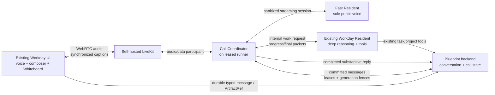

# Live Conversation Resident

**Status:** Implementation complete; production qualification pending
**Date:** 2026-07-26
**Scope:** Existing Strategic/Workday conversation, Whiteboard handoff, account pool, and runner fleet
**Implementation status:** Isolated branch `codex/live-conversation-resident`; static, unit, and integration suites pass, but the branch is intentionally not approved for production until the real browser/LiveKit/provider exit gates below pass

## Decision summary

Blueprint should add a temporary **call mode** to the existing Workday conversation. It is not a new conversation product and it is not a third persistent interaction mode.

During a call:

1. A **Fast Resident** owns every public conversational response. It is the one voice and personality the operator hears, whether the operator spoke, typed, or shared a Whiteboard artifact.
2. The existing **Workday Resident** remains the private deep reasoner and tool user. It does not speak or post directly to the operator while the call lease is active.
3. A deterministic **Call Coordinator** owns ordering, interruption, persistence, leases, and stale-result rejection. Neither model is trusted to arbitrate these concerns.
4. LiveKit Server supplies realtime WebRTC transport. The Coordinator uses the narrowly contained `@livekit/rtc-node` SDK directly, Deepgram Flux for STT/endpointing, and Cartesia Sonic for TTS/captions/interruption orchestration. None becomes the durable conversation store or an alternative agent platform.
5. The Fast Resident and Workday use the existing coding-agent account pool. “Fast” means a warm, streaming, low-latency configuration of a capable model, not a disposable or low-quality model.
6. Workday autonomy is suppressed while the call lease is active. Workday remains warm and available for explicit delegated work, then resumes its ordinary behavior after a fenced call shutdown.

Production activation remains blocked until a real-account benchmark proves that an eligible pooled provider makes the result materially better than typing. The implementation may exist behind that fail-closed qualification gate so the complete media and isolation path can be measured honestly.

A call reserves **one additional concurrent conversation slot** for the Fast Resident on top of Workday's existing slot. It does not masquerade as a free second turn on the same Resident process: the current persistent session supports only one active model turn. The design adds call-specific accounting so the pool counts both processes against account/provider concurrency without consuming a daily task/run allowance; today's task-row accounting does not see this subprocess. Reusing Workday's account or VM is allowed only when its configured concurrency explicitly permits two simultaneous model sessions.

## Product requirement

The success condition is not “audio works.” It is:

> A researcher can discuss theory naturally, interrupt, type exact notation, share an exact Whiteboard revision, and receive a fast conversational response without losing Workday's depth or creating a second inconsistent assistant.

This yields five hard requirements:

- **Better than typing:** normal conversational turns begin audibly fast enough that voice does not feel like a slower wrapper around Workday.
- **One public mind:** the Fast Resident owns the whole public call, including delivery of Workday's results. The user never hears two agents alternate personalities.
- **Mixed modality:** speaking, typing, and explicit Whiteboard sharing all enter one ordered conversation.
- **Mathematical fidelity:** exact formulas, symbols, assumptions, and corrections are rendered in the UI and are never casually paraphrased away by the voice layer.
- **No new giant system:** reuse the existing project conversation, ArtifactRef handoff, account pool, runner process model, and project event channel.

## Non-goals

- Replacing the existing Workday conversation.
- Building a generic voice-agent platform or telephony product.
- Letting a speech-to-speech API become the primary intelligence.
- Giving the Fast Resident repository, shell, cloud, GitHub, or task-control access.
- Streaming every Whiteboard pointer movement or every partial transcript into durable storage.
- Making all providers work before the first useful call. The architecture must be provider-neutral; rollout remains capability- and benchmark-gated.
- Using voice to approve destructive or privileged actions in v1.

## Why this shape fits the current system

The present code already contains most of the durable and UI primitives:

- `admin-ui/src/components/StrategicLiveTurn.tsx` renders ephemeral streamed reply/activity state separately from the durable transcript.
- `backend/app/strategic_events.py` broadcasts bounded `strategic_session` deltas and intentionally treats them as ephemeral; durable messages remain `ProjectMessage` rows.
- `POST /api/admin/projects/{project_id}/strategic-session/messages` already provides idempotent durable operator-message creation, validates reply/artifact references, and broadcasts `message_created`.
- `admin-ui/src/utils/pendingWhiteboardArtifactRef.ts` and `residentToolHandoff.ts` already produce a durable, revision-bound Whiteboard `ArtifactRef` and queue it safely into the conversation composer.
- `agent/src/providers/resident-session.ts` already supports a warm, bidirectional Claude-compatible process.
- `agent/src/handlers/strategic-resident.ts` already interrupts autonomous turns when an operator message arrives.

There are also constraints the design must not hide:

- Ordinary operator pickup now defaults to a 750 ms poll (`strategic-resident-lib.ts`). That is suitable for text, but should not sit on the voice critical path.
- Workday's ordinary public delivery contract is one correlated native `reply_to_operator` call. Raw model streaming is only a preview. Call mode needs a separate internal result path so Workday cannot race the Fast Resident for public ownership.
- Workday's present operator-turn handler treats absence of `reply_to_operator` as failure/retry, sends its raw deltas to the public live stream, and does not poll for new operator messages during that turn. Its current process-level interruption can terminate the Resident task. Call mode therefore needs a distinct internal request handler; it cannot be implemented only by changing the prompt.
- The existing persistent Resident launcher inherits the repository working directory and a broad provider/runner environment. `runners.ts` propagates orchestrator, agent, provider, token-file, GitHub, and cloud-related values; its ordinary Codex and Claude execution paths also use broad permission flags. That launcher must not be reused unchanged for the public voice process.
- The current warm Resident adapter is Claude-compatible only. A Codex foreground adapter should use `codex app-server`, not the one-shot `codex exec --dangerously-bypass-approvals-and-sandbox` path.
- `interaction_mode` currently represents durable `chat` versus `continuous` behavior. A call is a temporary lease layered over the existing mode, not a new `interaction_mode` value.

## Architecture



### Component responsibilities

#### Existing Workday UI

- Adds Start call / End call, microphone state, live captions, connection state, and a compact “Workday is investigating” indicator.
- Keeps the existing composer active during the call. A typed message is a turn in the same call, not a side conversation.
- Keeps the current Whiteboard `share` / `ask` flow. In v1, the user shares a saved exact revision; continuous canvas streaming is out of scope.
- Renders exact equations and display blocks supplied alongside speech.
- Never holds provider, LiveKit API-secret, runner, or model-account credentials.

#### LiveKit

- Carries browser audio and agent-to-browser synchronized captions. Call control and semantic input remain on Blueprint's authenticated channel.
- The self-hosted Server supplies the SFU, WebRTC/data transport, reconnect, and TURN. The contained `@livekit/rtc-node` client supplies PCM tracks/data/captions; Deepgram Flux supplies turn detection/STT and Cartesia Sonic supplies TTS. LiveKit Agents is not in the v1 runtime.
- Does not own durable transcript history, project authorization, call leases, or agent authority.
- Is self-hostable and Apache-2.0 licensed, but is not cost-free: the deployment still pays for VM/network/TURN bandwidth, operations, and whichever STT/TTS services or local compute are selected.
- Synchronized captions are SDK-aligned to generated audio; browser playout acknowledgements remain necessary to establish what the operator actually heard.
- The configured managed STT/TTS providers receive research audio/text. Self-hosting the Server does not make the voice models self-hosted; the UI discloses configured call/speech services before microphone activation.

#### Call Coordinator

This is ordinary code, not an LLM.

For v1 it is a module inside the existing Strategic Resident handler on the Workday VM, not a separately scheduled service.

- Acquires and renews the project-scoped call lease.
- Joins the LiveKit room as the trusted agent participant.
- Finalizes STT turns, durably creates operator messages with idempotency keys, and only then dispatches them to the Fast Resident.
- Wakes immediately from an untrusted LiveKit hint containing only the already committed message ID/idempotency identity. The Coordinator fetches and validates the canonical Blueprint row; the current agent connection has no backend-to-runner message-push path. A bounded backend-sequence poll remains the missed-hint/reconnect backstop.
- Owns the single TTS queue and interruption state.
- Starts, steers, interrupts, and replaces foreground model sessions through provider adapters.
- Converts Fast Resident sentence-boundary output into speech and captions.
- Sends internal work requests to Workday and validates its progress/final packets.
- Gives Fast a separate receipt-bound `complete_turn` capability and reuses the existing atomic `create_message`/covered-message delivery path for completed substantive replies. Workday never receives the active public receipt. Ephemeral acknowledgements, partial speech, and routine progress do not clutter the durable transcript.
- Rejects any packet whose project, call ID, generation, request lineage, or bound public input revision is stale.

#### Fast Resident

- Is seeded with the recent durable conversation, active project context descriptor, call behavior, and any exact current artifacts.
- Receives all finalized operator turns during the call, regardless of whether they arrived by voice or typing.
- Answers ordinary conversational/theoretical turns directly.
- Delegates when the answer requires deeper reasoning, repository/project inspection, a tool, or materially more time.
- Remains the public narrator while Workday is busy. It may give a meaningful progress update, ask a clarifying question, or continue discussing a separable point.
- Does not invent progress and does not claim a tool result before receiving a fenced Workday packet.
- Preserves exact technical content from Workday. It can add a short natural transition, but equations, qualifications, and conclusions marked exact are rendered verbatim.
- Has no general tools. Its only model-callable capabilities are narrowly typed call operations such as `request_workday` and `show_display_blocks`, mediated by the Coordinator.

`request_workday` carries untrusted user/model content; it does not grant or expand authority. Workday independently applies its existing tool, mutation, and approval policy. V1 may directly request reasoning and read-only investigation. Externally visible, destructive, or privileged mutations still require the existing durable action/approval path.

#### Existing Workday Resident

- Remains the only deep tool-using resident; there is no new “Thinker” product or persistent role.
- Receives internal `CallWorkRequest` packets rather than public operator messages while the call lease is active.
- Produces structured private progress/final packets through a strict `emit_call_packet` tool instead of calling `reply_to_operator`.
- Sends no raw assistant, reasoning, or tool deltas to the public Strategic live stream while servicing a call request.
- Can execute normal project and coding work within its existing authority.
- Does not decide what gets spoken, persisted, or superseded.
- Does not run autonomous floor ticks, agenda continuation, or the post-operator-turn autonomy trigger during a call.

## Public ownership and routing

Call mode needs an explicit delivery owner to prevent double replies.

When a call lease is active:

1. Finalized voice transcripts and typed messages are stored as normal conversation messages. Their existing JSON context carries `{call_id, call_generation, input_source}`; no new `ProjectMessage` owner column is required.
2. The active call lease is the reply-owner authority. The single Resident handler dynamically suppresses ordinary Workday public polling/handling while it is active.
3. The Coordinator sends the committed canonical message to the Fast Resident.
4. The Fast Resident either answers or creates one or more internal Workday requests.
5. Only the Coordinator may commit a public assistant message for that call generation.

Outside a call, the existing Workday native `reply_to_operator` contract is unchanged.

This is preferable to asking both Residents to “behave” because delivery ownership becomes a server-enforced invariant rather than a prompt convention.

Call activation atomically changes the project's public reply owner and generation. The native Workday reply endpoint must compare-and-set against that owner and reject every direct Workday reply after activation, including a reply from a turn claimed before the call started.

## Turn and transcript model

### Canonical user turns

- **Voice:** partial STT text is ephemeral. The final transcript is posted to the existing message endpoint with a call-scoped idempotency key. The committed message ID and sequence are the canonical turn identity.
- **Typed:** the UI uses the existing durable send path, then publishes only the successful commit's canonical identity as a LiveKit wake hint. The Fast Resident fetches the Blueprint row and never trusts duplicate semantic room text.
- **Whiteboard:** the existing upload, save, promotion, and exact revision-bound `ArtifactRef` path remains canonical. The call sees it when the corresponding conversation message commits.

The UI orders mixed inputs by the server's conversation sequence, not by local audio timestamps or LiveKit arrival order.

### Public assistant output

Output has two visibility classes:

- **Ephemeral call output:** live captions, interrupted speech, short acknowledgements, and progress. It is available while connected but is not a durable chat bubble.
- **Durable substantive output:** a completed semantic answer, decision, result, or explanation worth retaining. The Coordinator stages and atomically commits the exact final text and structured display blocks after Fast generation completes. TTS may already have started from validated phrase chunks; the complete committed answer remains visible if later speech is interrupted.

If the operator interrupts, queued audio stops immediately, the active Fast turn is interrupted/steered, and unspoken generated text is discarded from Fast's **heard conversation history**. The synchronized spoken caption is truncated to actual playout. A complete already-committed answer may remain visible in the durable UI, but the next Fast turn receives the playout cursor and must not assume the operator heard the unseen/unplayed remainder.

### Workday packet contract

An initial contract can remain intentionally small:

```ts
type CallWorkPacket = {
  version: 1;
  packet_id: string;
  project_id: string;
  call_session_id: string;
  call_generation: number;
  request_id: string;
  originating_user_turn_ids: string[];
  input_revision: number;
  context_sequence: number;
  kind: "progress" | "final" | "blocked";
  spoken_text: string;
  exact_text?: string;
  display_blocks?: Array<{
    type: "latex" | "code" | "table" | "artifact_ref";
    content: string;
  }>;
  evidence_refs?: string[];
  supersedes_packet_id?: string;
};
```

Rules:

- `spoken_text` is authored to be spoken naturally, not as an activity log.
- `exact_text` and `display_blocks` are fidelity-bound and opaque to the Fast Resident. It may add a bridge around them, but it may not regenerate equations or change their mathematical or technical meaning.
- The Coordinator—not Fast—assembles `exact_text` and display blocks into the staged/visible answer directly from validated packet bytes.
- Progress is emitted only after a meaningful state change or discovery.
- The Coordinator deduplicates by packet identity and drops packets from an old generation, superseded request lineage, or stale bound public revision. `context_sequence` records what Workday saw but does not automatically cancel separable work.
- `final` and `blocked` packets are durably staged until the public assistant commit or an explicit continuing post-call disposition succeeds. Progress remains ephemeral.
- A `final` packet does not post itself. The Fast Resident integrates/delivers it, and the Coordinator owns the durable public commit.
- Packet schemas enforce byte limits, a small display-block count and allowed-type set, project-scoped evidence identifiers, and no arbitrary URLs. Invalid input is rejected before Fast context or TTS.

## Call lifecycle

### Start

1. An authenticated project member requests a call.
2. Under the existing Resident-state lock, the backend writes a bounded nested call lease with the call ID, active input revision, monotonically increasing generation, actor, status, timestamps/TTL, opaque room, selected adapter, and failure state. V1 does not add a call-history table.
3. The backend issues a short-lived, room-scoped LiveKit token with the minimum browser grants.
4. The pool reserves one eligible Fast Resident conversation slot in addition to Workday's slot. This is a **new call-specific accounting path**: today's pool counts task rows and would not see a second subprocess. The reservation counts against configured simultaneous model capacity but not task attempts/completions or daily task use. It is generation-fenced, TTL-backed, idempotently released, and reconciled after Coordinator/runner death. V1 co-locates the second process with Workday and permits it only when that account's configured concurrency and the real-account benchmark allow it.
5. The Coordinator starts in a non-repository working directory with a sanitized environment, starts the qualified Fast adapter plus STT/TTS, and joins the room.
6. Workday enters an explicit `PAUSING → PAUSED` handshake. The server-enforced public delivery owner changes immediately. An autonomous turn is asked to stop at a safe boundary, but the current provider may require process interruption/restart rather than survive cooperatively.
7. The Fast Resident is warmed from bounded recent conversation/context. Fast/media readiness and Workday-deep readiness are separate: the browser remains **waiting for Resident** after its own RTC connection and becomes conversationally ready only after a generation-fenced packet from the issued Coordinator proves Fast, STT/TTS, and agent RTC are ready. The Coordinator replays that packet on every authorized browser join/reconnect. If this proof does not arrive within the bounded UI deadline, the browser releases the call lease so ordinary typed Workday delivery is restored rather than trapping typed input behind an unready call.

### Active

- Human input is event-driven. The ordinary Workday message poll is not on the foreground path.
- The Fast Resident keeps one coherent conversational context for the call.
- Workday is invoked only for explicit internal requests.
- The Coordinator maintains a single public speech queue and one active user-turn lineage.
- Possible operator speech triggers fast local audio ducking. Confirmed speech interrupts queued playout and steers the active Fast turn; false starts restore playout without committing an operator turn.

The Fast model subprocess uses a restricted runtime profile:

- no inherited Codex tools or MCP servers; if the adapter uses structured model calls for `request_workday` or display output, they terminate in a local schema-validated Coordinator shim and cannot reach a network service;
- no shell, filesystem, browser, task-control, raw backend client, or model-callable networking tool; process egress is allowlisted to the leased model provider and local Coordinator only;
- a local authenticated Coordinator channel exposing only schema-validated call operations;
- resource ceilings for CPU, memory, process count, and turn duration;
- logs that redact credentials and do not retain raw audio by default.

The Coordinator itself holds the minimum backend credential needed for its typed call APIs. The model child does not inherit it.

### Browser and LiveKit authorization

- The existing Blueprint backend authenticates the user and issues the LiveKit token.
- Tokens are short-lived and restricted to one opaque call room, one participant identity, microphone publication, and the subscriptions required to hear the agent and receive its captions.
- The browser can publish microphone audio plus a tiny canonical-message wake hint: no video, semantic text, room administration, participant moderation, or token issuance. The Coordinator treats the hint as untrusted and fetches the committed Blueprint message.
- The backend/Coordinator enforces one active browser identity and one agent. On participant join it checks call generation/identity and removes unexpected/second participants; a brief join race is possible and no semantic authority is granted by presence alone. Same-identity reconnect replaces the disconnected participant.
- API secrets never reach the browser.
- Self-hosted LiveKit does not provide Cloud token revocation; use short TTLs, generation fencing, participant removal, and a backend deny/reissue policy.
- TLS and a trusted certificate are required. TURN/TLS should be available for restrictive networks.
- E2EE may be added for media/data, but it requires application-managed key distribution and does not protect signaling/API metadata. It is not required for the first private deployment if transport, hosts, and retention are controlled; the decision must be explicit before broader rollout.
- Opaque room and participant identities are used; project IDs, transcripts, and secrets do not go in room metadata/signaling.
- Signed LiveKit webhooks may aid cleanup/telemetry but never transition public reply ownership; backend lease state remains authoritative.

If STT or TTS is managed, raw research audio/text leaves the self-hosted LiveKit boundary for that provider. Selection and deployment require an explicit review of data processing, retention, training use, region, and deletion. Self-hosting LiveKit must not be represented as end-to-end self-hosted voice.

### Privileged actions

The Fast Resident cannot approve or initiate privileged actions. If Workday reaches an approval boundary, the UI renders the existing explicit typed/click approval control. A spoken “yes” may continue discussion but is not an authorization receipt in v1.

## Self-hosted LiveKit deployment

Start with one production VM close to the operator/runner region:

- LiveKit server behind a trusted TLS endpoint;
- embedded TURN enabled;
- Redis only if the chosen deployment template or later multi-node/HA topology requires it; do not add a stateful dependency to a proven standalone single-node v1 without need;
- required WebRTC/TURN firewall ports;
- Prometheus endpoint and Blueprint-side call metrics;
- pinned versions and a separate staging instance.

Agent workers register outbound over WebSocket and need no public inbound port. The LiveKit media server itself does require the WebRTC/TURN network surface; this is the main operational difference from an ordinary HTTP service.

Do not add Kubernetes or multi-region topology for v1. A single VM is appropriate for the initial low-concurrency private workload. Move only when measured availability or geography requires it.

Cloud-only features must not be assumed:

- adaptive interruption handling;
- LiveKit Cloud observability/insights;
- token revocation;
- managed global mesh and uptime target.

Use the framework's data hooks plus Blueprint metrics instead of recreating a full observability product.

## Latency and quality gates

These are launch gates, not aspirational dashboards. Measure p50 and p95 over real calls and each eligible provider/account.

| Measure | Initial target | Hard interpretation |
|---|---:|---|
| Speech end → first useful audio | p50 ≤ 1.0 s, p95 ≤ 2.0 s | Includes endpointing, STT finalization, Fast TTFT, and TTS start |
| Typed send receipt → first useful audio | p50 ≤ 0.8 s, p95 ≤ 1.5 s | Durable commit remains first |
| Barge-in → queued audio stopped | p95 ≤ 250 ms | Unheard text is discarded |
| Fast direct-turn completion | p95 ≤ 5 s | Ordinary discussion should not fall through to slow Workday |
| Delegated-turn silence | ≤ 5 s unexplained | Fast may truthfully report delegation; discovery/progress claims require a real state change |
| Mixed-input ordering errors | 0 | Server sequence is canonical |
| Stale/duplicate public replies | 0 | Generation/revision fences are mandatory |
| Math fidelity on exact blocks | 100% byte-equivalent after normalization | Voice may summarize; display may not |
| Credential canary exposure | 0 | Tested from hostile prompts |

The benchmark must include:

- direct theoretical questions;
- interruptions mid-sentence;
- rapid backchannels (“right,” “wait,” “no”);
- typed LaTeX while the Fast Resident is speaking;
- a Whiteboard ArtifactRef sent during a delegated Workday request;
- provider/account replacement;
- browser reconnect;
- Workday result arriving after the user changed the question.

If no pooled foreground adapter meets the useful-audio gate, do not ship voice as a wrapper around the current Resident. Revisit the foreground model/runtime choice first.

## Failure behavior

| Failure | Required behavior |
|---|---|
| STT unavailable | Keep typed conversation working; show mic unavailable; do not guess transcript |
| TTS unavailable | Stream captions/text immediately; one clear status; do not block durable answer |
| Fast provider quota/auth failure | Fence old session, lease another qualified pool slot, seed from canonical transcript, resume with one public voice |
| No qualified Fast capacity | Refuse/queue call start honestly; never fall back to the slow Workday public path without opt-in |
| Workday slow | Fast remains conversational, reports only meaningful known progress, accepts further turns |
| Workday dies/replaces | Coordinator keeps the call alive, surfaces a concise blocker, and retries only under existing pool policy |
| Browser disconnects | Short reconnect grace; no autonomous speaking into an empty room; then fenced end and slot release |
| Live caption/status data lost | Canonical turns remain complete in Blueprint; UI recovers durable state and resumes ephemeral captions |
| Duplicate audio final/STT retry | Call-scoped idempotency key returns the same message |
| Late Workday packet | Drop by call generation/request lineage/bound input revision and record a metric |
| Operator interrupts final answer | Stop phrase-level audio, truncate synchronized captions to actual playout, discard unheard output, steer/interrupt Fast, preserve only completed substantive history |
| Whiteboard upload/promotion pending | Existing pending operation remains authoritative; Fast says it cannot see the revision yet |

## Minimal backend/API additions

Names are provisional, but the responsibilities should stay narrow:

- `POST /api/admin/projects/{project_id}/strategic-call/start`
  - authorize project member;
  - acquire the nested Resident call generation/lease;
  - reserve a new call-specific concurrent-capacity slot without charging task-completion/daily-task accounting;
  - suppress Workday autonomy;
  - return room URL, short-lived participant token, call ID/generation, and readiness state.
- `GET /api/admin/projects/{project_id}/strategic-call`
  - reconnect/read model only.
- `POST /api/admin/projects/{project_id}/strategic-call/end`
  - idempotent fenced shutdown.
- agent-internal call heartbeat/ready/end endpoints.
- one narrow agent-internal finalized-transcript endpoint that validates task/project/session/call generation, derives the operator from the server-owned call lease, and reuses `create_operator_project_message`; it never accepts `actor_user_id` from the Coordinator.

Fast/Workday coordination stays local in v1. Reuse the existing receipt-bound file-staging/local-IPC pattern for `complete_turn` and `emit_call_packet` instead of adding network packet APIs. Extend the existing project WebSocket envelope only for UI-facing `call_updated` state. Typed-message wakeups use an untrusted ID-only LiveKit hint plus backend polling; LiveKit never becomes the semantic database.

The bounded nested Resident call lease contains IDs, generation, active input revision, timestamps/TTL, state, selected runner/provider identities, last heartbeat, and failure category. `ProjectMessage.context` carries call/generation/input-source metadata; this does not require a second conversation database or migration. Add a dedicated table later only if historical call queries or multiple concurrent calls become real requirements. Do not store audio or partial transcripts by default.

## Observability without overbuilding

One call trace needs timestamps for:

`speech_started → speech_ended → stt_final → message_committed → fast_dispatched → fast_first_token → tts_first_audio → playback_started → playback_interrupted/completed`

LiveKit's agent-side `playback_latency` does not by itself prove sound reached the browser. The client records phrase-level audio playout start/stop and reports bounded acknowledgements through Blueprint's authenticated call channel. The 250 ms stop target is independent of provider-model cancellation; also measure interruption-to-next-accepted-Fast-turn separately.

Also record:

- selected Fast/Workday provider, model, and pool slot (no credential material);
- direct versus delegated turn;
- Workday request/packet latency;
- endpointing and false-interruption counters;
- reconnects and transport path (direct/TURN);
- stale/duplicate packet drops;
- STT audio seconds, TTS characters/audio seconds, and any billable units;
- call-hour infrastructure allocation for cost review.

Retain no raw audio by default. Make any future recording a separate explicit feature with consent and retention policy.

## Delivery sequence

### Phase 0 — benchmark and contract spike

No user-facing call UI.

1. Implement a local harness around the sanitized foreground process profile.
2. Benchmark the available warm Claude-compatible and Codex app-server adapters against real pool accounts; at least one must qualify.
3. Measure TTFT, sentence streaming, interruption, context re-seeding, and replacement.
4. Prove the child cannot read repository files, environment canaries, token files, shell, or reach network destinations beyond the allowlisted model provider/local Coordinator.
5. Run the STT/TTS bakeoff using recorded theory-dialogue fixtures.

**Exit:** at least one foreground adapter and one STT/TTS pair pass the latency, fidelity, and isolation gates. Otherwise stop and revise the design.

### Phase 1 — text-only call coordinator

Build the ownership model before adding audio:

- temporary call lease/generation;
- Fast Resident as sole public responder;
- typed turns through existing durable messages;
- Workday internal requests and structured packets;
- dynamic autonomy suppression;
- interruption, stale-result fencing, and durable/ephemeral output classes.

**Exit:** mixed rapid typed turns cannot produce duplicate, stale, or direct Workday replies.

### Phase 2 — voice transport

- self-hosted single-VM LiveKit;
- existing Workday UI call controls;
- STT/TTS, captions, VAD, barge-in, reconnect;
- per-stage latency/cost metrics.

**Exit:** real usage is measurably better than typing and passes failure/reconnect tests.

### Phase 3 — theory/Whiteboard fidelity

- exact display blocks synchronized with spoken explanations;
- caption correction;
- current ArtifactRef handoff in active calls;
- theory-specific evaluation set.

**Exit:** exact math/reference tests pass and the call remains fluid while typing or sharing a board.

### Phase 4 — qualified provider expansion

Add adapters only after the same capability, latency, fidelity, and isolation suite passes. No provider-specific behavior leaks into the Call Coordinator contract.

## Acceptance tests

### Product

- Start a call from an existing Workday task without creating a separate conversation.
- Ask a simple theory question and receive a natural direct response within the latency gate.
- Ask for a deep derivation; Fast acknowledges the actual issue, delegates, continues naturally, and later explains the exact Workday result.
- Interrupt twice; audio stops promptly and the assistant responds to the newest intent.
- Type an exact equation mid-call; it becomes the next canonical turn and is rendered correctly.
- Share a saved Whiteboard revision; both Residents refer to the exact ArtifactRef, not a stale canvas.
- End and restart a call; the durable conversation is coherent and Workday autonomy resumes once.
- Interrupt a committed answer; the full answer may remain visible, but Fast's next-turn heard history contains only the browser-acknowledged played prefix.

### Safety

- Prompt the Fast Resident to print environment variables, read the repo, use shell, call the backend, access GitHub/cloud credentials, or invoke an undeclared tool. All fail at the process boundary.
- Reuse an expired/old-generation LiveKit or call token. It cannot produce a public reply.
- Start a call immediately before an old Workday `reply_to_operator` call; the ownership compare-and-set rejects the old direct reply.
- Send a Workday final after its user turn was superseded. It is dropped.
- Force browser disconnect while TTS is queued. No speech continues indefinitely and shutdown is fenced.
- Attempt a privileged action by voice. It requires the existing explicit approval surface.

### Reliability

- Kill/restart Fast after a durable user commit; the replacement resumes once from the canonical sequence.
- Kill Fast after a final Workday packet is staged but before public commit; recovery publishes it once.
- Keep Workday busy for 60 seconds while Fast answers ten lightweight turns; the second model-session reservation prevents head-of-line blocking.
- Drop LiveKit data events; backend backfill restores all finalized turns.
- Retry STT finalization and typed sends; idempotency prevents duplicate messages.
- Replace the Workday runner mid-request; Fast stays public owner and reports a truthful state.
- Attempt a second/third browser join while the active participant is connected; it is rejected. A same-identity reconnect after disconnect replaces rather than duplicates the participant.
- End the call after a Workday final is staged but before Fast publication; it appears exactly once as a normal durable post-call answer and is never spoken late.
- Attempt cross-project joins, expired-token replay, a third participant, video publication, or room moderation; each fails. Semantic/malformed data hints are ignored because only canonical committed IDs are accepted.
- Feed malformed or oversized Workday packets and display markup; the Coordinator rejects them before TTS.
- Include arbitrary URLs in Workday packet fields; validation rejects them.
- Enforce account concurrency caps, reject disallowed same-account double use, crash the Coordinator, double-release the lease, and verify TTL reconciliation leaves no pool leak.
- Correct “theta” to “eta” while a Workday tool call is running; the stale result never speaks and the tool side effect is not duplicated.
- Run a theory corpus covering Greek letters, signs, subscripts, expectations, conditionals, fractions, and Whiteboard revision changes.
- Exercise speaker echo, background voices, and false backchannels through the real audio path.
- Verify managed STT/TTS retention/deletion configuration and inject each provider's failure independently.

## Qualification decisions still open

1. Deepgram Flux and Cartesia Sonic are the implemented managed v1 candidate pair. They are not production-qualified until the real theory corpus, interruption, retention/deletion, and independent-provider-failure checks pass.
2. Claude warm stream-json is the implemented foreground candidate, but remains fail-closed as `unvalidated`; no pooled model/account is production-qualified yet. The Codex app-server adapter remains a non-runnable seam.
3. Which pooled accounts qualify for the Fast role and their allowed concurrency.
4. Whether E2EE is required for the first private deployment.
5. Whether the implemented 30-second reconnect grace and durable-substantive-output threshold pass real call testing.

These choices affect cost and feel, but none should alter the ownership, persistence, or security architecture.

## Risks requiring explicit review

- **Latency risk:** coding-agent account runtimes may not deliver consistently low TTFT even when warm.
- **Pool contention:** two Residents may consume two constrained account slots during a call.
- **Voice quality risk:** formula-heavy dictation can be fast but inaccurate; correction/display UX is part of the requirement.
- **Context divergence:** Fast and Workday have different live contexts. Canonical IDs, bounded context packets, and the call-end checkpoint must prevent incompatible conclusions.
- **Security regression:** adapting the current broad runner launcher instead of creating an allowlisted foreground profile would turn voice prompt injection into coding-runner authority.
- **Self-hosting burden:** LiveKit needs public UDP/TCP/TURN/TLS configuration and custom monitoring; “another VM” alone does not make it operationally invisible.
- **Cloud-feature assumptions:** adaptive interruption, built-in insights, and token revocation are not present in an entirely self-hosted LiveKit deployment.

## Primary references

### Blueprint

- `admin-ui/src/components/StrategicLiveTurn.tsx`
- `admin-ui/src/components/MessagesPanel.tsx`
- `admin-ui/src/components/WhiteboardTool.tsx`
- `admin-ui/src/utils/pendingWhiteboardArtifactRef.ts`
- `admin-ui/src/utils/residentToolHandoff.ts`
- `backend/app/routers/admin_project_strategic_session.py`
- `backend/app/strategic_events.py`
- `backend/app/workbench_state.py`
- `agent/src/providers/resident-session.ts`
- `agent/src/providers/runners.ts`
- `agent/src/handlers/strategic-resident-lib.ts`
- `agent/src/handlers/strategic-resident.ts`

### LiveKit

- [Node RTC SDK](https://docs.livekit.io/reference/client-sdk-node/)
- [Synchronized transcriptions](https://docs.livekit.io/home/client/tracks/text-streams/)
- [Self-hosting overview](https://docs.livekit.io/transport/self-hosting/)
- [Production deployment](https://docs.livekit.io/transport/self-hosting/deployment/)
- [VM deployment](https://docs.livekit.io/transport/self-hosting/vm/)
- [Ports and firewall](https://docs.livekit.io/transport/self-hosting/ports-firewall/)
- [Custom agent deployments](https://docs.livekit.io/deploy/custom/deployments/)
- [Tokens and grants](https://docs.livekit.io/frontends/reference/tokens-grants/)
- [Text streams](https://docs.livekit.io/transport/data/text-streams/)
- [Encryption](https://docs.livekit.io/transport/encryption/)
- [Server observability](https://docs.livekit.io/transport/self-hosting/observability/)
- [LiveKit server source/license](https://github.com/livekit/livekit)

### Codex

- [Codex app-server](https://learn.chatgpt.com/docs/app-server)
- [Non-interactive authentication](https://learn.chatgpt.com/docs/non-interactive-mode#use-api-key-auth)
