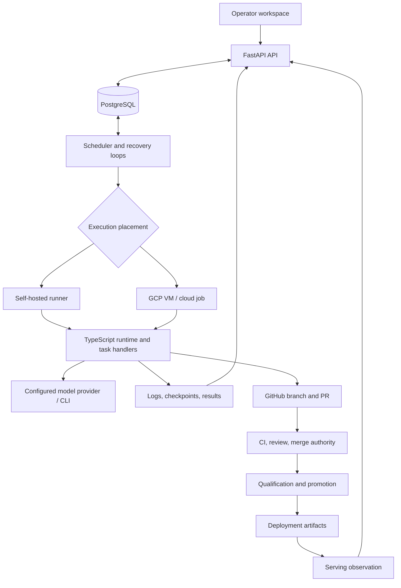

# Architecture and source guide

Blueprint is a control plane for repository work performed by AI agents. The backend persists intent and execution state; workers perform bounded tasks; the operator workspace makes progress, failures, and decisions visible.

The existing operator workspace starts at `admin-ui/src/main.tsx` and `admin-ui/src/App.tsx`. The files below map the implementation.

## Component boundaries

| Boundary | Entry points | What to inspect |
| --- | --- | --- |
| HTTP and application lifetime | [`main.py`](../../backend/app/main.py), [`lifecycle.py`](../../backend/app/lifecycle.py), [`routers/`](../../backend/app/routers/) | Authentication dependencies, schema checks, API/worker roles, background leadership |
| Persistent state | [`models.py`](../../backend/app/models.py), [`database.py`](../../backend/app/database.py), [`alembic/versions/`](../../backend/alembic/versions/) | Projects, tasks, artifacts, attempts, release records, and immutable schema history |
| Dispatch and placement | [`orchestrator.py`](../../backend/app/orchestrator.py), [`orchestrator_filters.py`](../../backend/app/orchestrator_filters.py), [`orchestrator_runner_placement.py`](../../backend/app/orchestrator_runner_placement.py) | Eligibility, dependencies, capacity, fairness, and execution placement |
| Task mutations | [`task_locking.py`](../../backend/app/task_locking.py), [`task_lifecycle.py`](../../backend/app/task_lifecycle.py), [`task_completion.py`](../../backend/app/task_completion.py) | Lock acquisition, admission decisions, completion processing, and parent/child workflows |
| Agent execution | [`index.ts`](../../agent/src/index.ts), [`handlers/`](../../agent/src/handlers/), [`providers/runners.ts`](../../agent/src/providers/runners.ts) | Claiming a task, workspace preparation, provider execution, and reporting results |
| Local execution | [`local_runner.py`](../../scripts/local_runner.py), [`blueprint_runner.py`](../../scripts/blueprint_runner.py) | Enrollment, capabilities, execution isolation, heartbeats, and local capacity |
| Recovery | [`reaper.py`](../../backend/app/reaper.py), [`recovery_sweeps.py`](../../backend/app/recovery_sweeps.py), [`services.py`](../../backend/app/services.py) | Missing heartbeats, orphaned work, bounded sweeps, and pending completion retries |
| Review authority | [`review_merge_authority.py`](../../backend/app/review_merge_authority.py), [`review_pipeline.py`](../../backend/app/review_pipeline.py) | Exact base/head identity, blocker ledger, active fixes, and permission to submit a merge |
| Release authority | [`release_qualifier.py`](../../backend/app/release_qualifier.py), [`release_promotion.py`](../../backend/app/release_promotion.py), [`release_serving_observation.py`](../../backend/app/release_serving_observation.py) | CI qualification, promotion, deployment artifacts, and observation applied against current authority |
| Operator interface | [`App.tsx`](../../admin-ui/src/App.tsx), [`components/`](../../admin-ui/src/components/), [`api/`](../../admin-ui/src/api/) | Project workspace, conversations, pipeline, fleet, and authenticated data access |

## A repository task, end to end

1. The operator submits a prompt and repository context. The API validates access and task payloads, then records a task.
2. The scheduler selects eligible queued work. Dispatch checks dependencies, conflicts, project policy, and available execution capacity.
3. The selected runtime claims the task, prepares a workspace and branch, and executes the configured provider. Heartbeats, logs, and results return to the control plane.
4. Completion handlers interpret the result according to task capability. A code-producing task can enter CI/review processing; research and compute tasks have different result contracts.
5. Review/fix processing decides whether the current change is mergeable. Authority is tied to the checked revision and relevant blockers, not just a remembered approval flag.
6. Release qualification, promotion, deployment, and serving confirmation have separate persisted state and evidence.

This is a reading order, not a complete state machine. The implementation also includes blocked and parked work, cancellation, retry attempts, warm execution reuse, research cycles, and conversational sessions. Read [TASK_LIFECYCLE.md](../TASK_LIFECYCLE.md) and the current handlers for those paths.

## Three useful implementation tours

**Concurrency:** start with `automatic_task_creation_decision` and `acquire_automatic_task_creation_authority` in [`task_locking.py`](../../backend/app/task_locking.py). Then inspect [`test_task_locking.py`](../../backend/testing/test_task_locking.py), including concurrent mutation and advisory-lock cases. The lock helpers reload state under the lock and provide explicit contention behavior.

**Agent permissions:** compare the backend [`task_capabilities.py`](../../backend/app/task_capabilities.py) with [`taskCapabilities.ts`](../../agent/src/taskCapabilities.ts). The backend publishes the permission partition; the runtime validates completeness before classifying a known task as writable or read-only. Read [`test_task_capabilities.py`](../../backend/testing/test_task_capabilities.py) for the backend contract.

**Serving verification:** inspect [`release_serving_observation.py`](../../backend/app/release_serving_observation.py) and [`test_release_serving_observation.py`](../../backend/testing/test_release_serving_observation.py). External provider observation happens without holding authority row locks; a short transaction rejects observations whose authority baseline changed before application.

## Scope and tradeoffs

The system grew from cloud VM orchestration into a broader platform with local runners, multiple provider paths, compute/research workflows, and conversational operation. Its persistence and recovery mechanisms are substantial, while the source remains uneven: many flat backend modules, large coordination files, and compatibility surfaces retained for tests and older persisted state.

New development should preserve the supported Workday conversation and artifact handoff surfaces and respect the retired architecture boundaries in [AGENTS.md](../../AGENTS.md).
